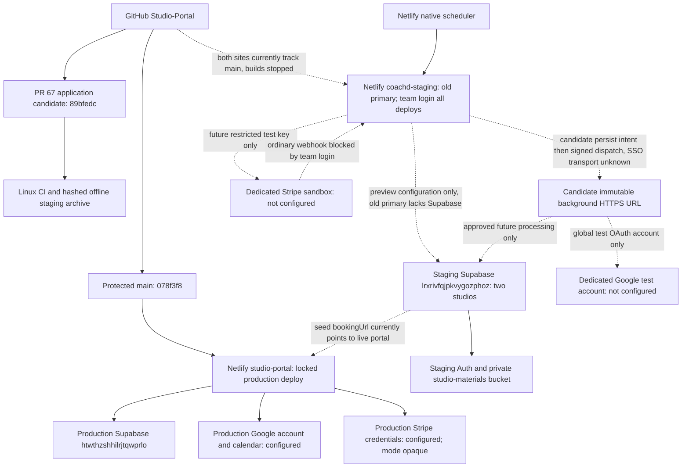

# PR #67 staging authorization and isolation audit

October 26, 2026; read-only inspection through approximately 23:46 UTC. **Environment isolation: FAIL. Release: NO-GO.** This is an execution proposal, not authorization to execute it.

The reviewed application candidate is `89bfedc14cbd8a0c3e61ee95bbed486760765761` on `codex/weekly-audit-remediation-2026-10-26`, [draft PR #67](https://github.com/coach-sudo/Studio-Portal/pull/67). Portal production remains `078f3f83a456d049b28c287b69d4e4a46c3f6056`. This audit changes documentation only. No deployment, migration, environment setting, hosted identity/record, provider invocation, scheduler invocation or payment was changed/executed. Existing automatic requests were observed, not initiated.

Any documentation-only commit containing this report is separate from that reviewed application/artifact identity. The cited CI and package results remain bound to89bfedc; they do not assert a newly rebuilt or hosted artifact for a later documentation head. This report is prepared locally without pushing or triggering a build.

## 1. Decision and critical blockers

1. **Confirmed staging data/configuration contamination:** seed studio `11111111-1111-4111-8111-111111111111`, slug `stage-story`, has a production-host reference in `settings.bookingUrl`, a real contact address in `settings.contactEmail`, and one non-reserved address in `settings.coachEmails`. Values are deliberately omitted. Intake scans this studio as well as `coachd-staging`; `STUDIO_ID` does not constrain it. A clean URL/key inventory alone cannot establish isolation.
2. **Full synthetic provenance remains UNKNOWN:** current contacts strongly support synthetic fixtures, but neither an email suffix nor historical fixture documentation attests every current lesson, material, note, audit record and linked identity. Existing records must be preserved and the complete database scope approved before workers run.
3. **Old primary timers are already active:** staging's old published deployment has four schedules. Stopping builds did not stop them. In 22:35–23:35 UTC, scheduler-origin edge counts show **42 HTTP 502 responses**. Three recent intake requests failed around one second with `Supabase is not configured.` This is old-deploy evidence, not PR #67 verification or proof that every historical secret snapshot is harmless.
4. **Candidate primary-context incompatibility:** [portal-url.ts](../netlify/functions/_shared/portal-url.ts) deliberately rejects `context=production` with staging's site URL. [Existing regression](../netlify/functions/_shared/portal-email.test.ts) asserts that rejection. Consequently, primary-context booking/payment links, outbox presentation and the maintenance renewal-link stage cannot be accepted on this exact candidate merely by copying preview variables. A separately authorized, narrow trusted-staging-identity correction and a new candidate/artifact are needed before full primary acceptance. Never spoof `URL` as portal production or override `CONTEXT` to avoid the guard.
5. **Hosted dispatch and payments have perimeter blockers:** team login protects every staging deploy. Native scheduled invocations demonstrably reach the old handler; the repaired handler's outbound HTTPS request to its immutable background URL is a different path and remains UNKNOWN. No supported machine credential/path has been established. Stripe also needs publicly reachable webhook delivery; the current private perimeter prevents ordinary unauthenticated delivery. Preserve SSO and classify these checks BLOCKED until a supported, reviewed design exists.
6. **Schema, credentials and access:** migration `20261026161014` is absent; staging has no Google or Stripe variables. Approved current-target coach/student/guardian/unrelated credentials and new write scope are unavailable. Stripe connector inspection requires reauthentication. Supabase Auth redirect/SMTP configuration and the actual Stripe sandbox/webhook configuration remain UNKNOWN.
7. **Release review:** active main rules require checks but zero approvals, whereas [release-safety.md](release-safety.md) calls for one. PR #67 is draft with no approving review. No publication is authorized.

## 2. Verified environment map

| Boundary                          | Portal production                                                                                                  | Dedicated staging                                                                                                    |
| --------------------------------- | ------------------------------------------------------------------------------------------------------------------ | -------------------------------------------------------------------------------------------------------------------- |
| Netlify site                      | `studio-portal`; `93829451-dbcf-4863-a07f-fa448cb17494`                                                            | `coachd-staging`; `d83ff6cb-f57b-4741-8c3c-3eaae7adab19`                                                             |
| Primary HTTPS domain              | `https://portal.d-a-j.com`                                                                                         | `https://coachd-staging.netlify.app`                                                                                 |
| Published deployment              | `6ad8e4ee73c3bc97c37dd94f`, ready, **locked**, published October 21                                                | `6ace53e7f850061d7c49b711`, ready, published October 13; lock field null, not evidence of a lock                     |
| Immutable origin                  | `https://6ad8e4ee73c3bc97c37dd94f--studio-portal.netlify.app`                                                      | `https://6ace53e7f850061d7c49b711--coachd-staging.netlify.app`                                                       |
| Published source                  | `078f3f83a456d049b28c287b69d4e4a46c3f6056`                                                                         | `6df35d700cc13d60ceab3e92293635575479ec4d`; **not PR #67**                                                           |
| Git integration / primary branch  | Same GitHub repository; `main`                                                                                     | Same GitHub repository; `main`                                                                                       |
| Primary deployment methods        | Git production branch only; CLI/MCP/API primary deployment prohibited by site setting                              | Same Git-only restriction                                                                                            |
| Automatic builds                  | Stopped                                                                                                            | Stopped                                                                                                              |
| Branch / PR contexts              | Only primary branch; PR previews disabled                                                                          | Only primary branch; previews configured for PRs against primary/branch-deploy branches                              |
| Visitor perimeter                 | Public; application authentication remains required                                                                | Netlify team login, **all deploys**; not Supabase app authentication                                                 |
| Published context name            | `production`                                                                                                       | `production` also: context describes this site's primary deployment, not which business environment it serves        |
| Supabase project / DB             | `htwthzshhilrjtqwprlo`, `Studio-Portal`; `db.htwthzshhilrjtqwprlo.supabase.co`, PostgreSQL 17.6.1.155, `us-west-2` | `lrxrivfqjpkvygozphoz`, `coachd-staging`; `db.lrxrivfqjpkvygozphoz.supabase.co`, PostgreSQL 17.11.0.003, `us-west-1` |
| Function/client URL configuration | Production-context URL points to production project                                                                | Preview-context URLs point to staging project; public anon JWTs identify staging and role `anon`                     |
| Candidate hosted deployment       | None                                                                                                               | None. The prepared Linux archive is not a Netlify deployment.                                                        |

Netlify team ID is `6877f0feedb69199c7837fb3`. Both Supabase projects belong to organization `rxzyygvgbjozomkgocnu`; separate project IDs isolate databases, not organization-level administrators. The unrelated inactive WAM project is excluded from this plan.

Dashboard readback confirms build command `npm run build`, publish directory `dist`, functions `netlify/functions`, and no listed build hooks on either site. UI Node default is 24; repository `netlify.toml` pins Node 22. Do not alter either during this audit. Build queues, archived function environment snapshots and every possible external automation are not exhaustively proven absent.

### Variable inventory: names, scopes and contexts only

| Site       | Variable names                                                                                                                                                                  | Scope                                                  | Nonempty configured contexts |
| ---------- | ------------------------------------------------------------------------------------------------------------------------------------------------------------------------------- | ------------------------------------------------------ | ---------------------------- |
| Staging    | `VITE_SUPABASE_URL`, `VITE_SUPABASE_ANON_KEY`, `VITE_QUERY_LAYER_V2`                                                                                                            | Builds                                                 | `deploy-preview` only        |
| Staging    | `SUPABASE_URL`, `SUPABASE_ANON_KEY`, `STUDIO_ID`, `STUDIO_SLUG`, `E2E_STUDIO_ID`                                                                                                | Functions                                              | `deploy-preview` only        |
| Staging    | `SUPABASE_SERVICE_ROLE_KEY`, `E2E_FIXTURE_TOKEN`                                                                                                                                | Functions; marked secret                               | `deploy-preview` only        |
| Production | `VITE_SUPABASE_URL`, `VITE_SUPABASE_ANON_KEY`, `VITE_QUERY_LAYER_V2`                                                                                                            | Builds                                                 | `production` only            |
| Production | `SUPABASE_URL`, `SUPABASE_ANON_KEY`, `SUPABASE_SERVICE_ROLE_KEY`, `STUDIO_SLUG`, `GOOGLE_ACCOUNT_EMAIL`, `GOOGLE_OAUTH_CLIENT_ID`, `GOOGLE_REFRESH_TOKEN`, `GOOGLE_CALENDAR_ID` | Functions; service key and refresh token marked secret | `production` only            |
| Production | `GOOGLE_OAUTH_CLIENT_SECRET`, `STRIPE_SECRET_KEY`, `STRIPE_WEBHOOK_SECRET`                                                                                                      | Builds, functions, runtime; marked secret              | `production` only            |

Staging has ten site variables, production fourteen; team-shared environment inventory is empty. Production's other context entries are empty, not valid credentials. Staging has no configured Google/Stripe names or primary-context Supabase variables. Secret values remain opaque. Current service-key ownership/uniqueness and production Stripe mode cannot be attested from redacted metadata; no secret was printed or copied. Historical staging setup recorded a matching service-role key, but that is not a fresh cryptographic verification of the current value. Existing GitHub public packaging variables mirror staging's URL/anon key and are not function/provider credentials.

### Trust-boundary diagram

The dotted seed link is a confirmed unsafe navigation/reference, not evidence that staging has made a production database write. Netlify team login does not protect direct Supabase Auth/REST/Storage endpoints; their grants and RLS are independent boundaries. The CSP allows broad `*.supabase.co` connections and is not a project isolation allowlist.

### Connection-by-connection isolation assessment

| External connection                        | Verdict                                     | Evidence / limit                                                                                                                                                                                                                          |
| ------------------------------------------ | ------------------------------------------- | ----------------------------------------------------------------------------------------------------------------------------------------------------------------------------------------------------------------------------------------- |
| Staging client/server Supabase URL         | PASS                                        | Both URLs identify `lrxrivfqjpkvygozphoz`; anon role/ref checked in memory. No production URL configured there.                                                                                                                           |
| Staging service credential provenance      | UNKNOWN                                     | Secret redacted; historical attestation exists. Secure owner confirmation/reprovisioning of staging-only credentials required before execution.                                                                                           |
| Database-wide synthetic scope              | UNKNOWN                                     | Reserved contacts and fixture history support synthetic origin; current records still need complete manifest/owner attestation.                                                                                                           |
| Seed navigation/contact configuration      | FAIL                                        | Production `bookingUrl`, real `contactEmail`, non-reserved `coachEmails`; same seed is included in intake scope.                                                                                                                          |
| Staging storage                            | PASS for observed project/bucket boundary   | One private `studio-materials` bucket, zero storage objects/file assets. Two material external URLs contain no known production portal/project reference; their content/ownership is UNKNOWN and was not fetched.                         |
| Database outbound links/jobs               | PASS for inspected catalog                  | No foreign servers/tables, `pg_cron`, `pg_net`/HTTP queue, or application triggers whose bodies reference HTTP/net/dblink. No staging Supabase Edge Functions. This does not attest platform Auth email configuration.                    |
| Google account/calendar/mail               | UNKNOWN / execution BLOCKED                 | No staging credentials currently configured. Same token/calendar is global to all scanned studios; no per-studio credential boundary.                                                                                                     |
| Gmail sends / Calendar invitations         | FAIL as a future send-containment guarantee | No general hosted recipient sink/allowlist in `sendGmail`; calendar projection uses `sendUpdates=all`. Read-only provider scopes and isolated accounts are required for the intake-only lane; send/write scopes cannot be added casually. |
| Background dispatch through SSO            | UNKNOWN                                     | Native scheduler reaches old handler; outbound signed `fetch` to immutable background URL is untested. HMAC authorizes the application after the platform perimeter and cannot authenticate Netlify team login.                           |
| Stripe key / sandbox / webhook destination | UNKNOWN / execution BLOCKED                 | No staging keys; connected Stripe app requires reauthentication. Current webhook handler checks Stripe signature but has no explicit `livemode=false` guard. Key, signing secret and event/account provenance must all be test-only.      |
| Old published staging environment          | UNKNOWN beyond observed failure             | Recent intake exits before DB creation because Supabase is absent. Current variable deletion does not prove every historical deployed secret snapshot was removed. Do not invoke old background functions.                                |
| Application redirects / Auth SMTP          | UNKNOWN                                     | Supabase Auth Site URL, redirect allowlist, OAuth grants, SMTP recipients and external dashboard webhooks not exposed by the available project metadata. Owner/dashboard verification required.                                           |
| Git-to-production boundary                 | PASS for current safeguards                 | Production main-only, previews off, locked deploy, stopped builds; no settings changed. Both sites tracking main is a coupling to remove on staging only before staging publication.                                                      |

## 3. Staging data and exact migration review

All remote SQL in this audit explicitly targets `lrxrivfqjpkvygozphoz` and runs inside `BEGIN READ ONLY ... COMMIT`. No row payloads, names, addresses, tokens or private provider bodies were exported. Counts and configuration-path flags are observations, not test-fixture creation authority.

The two studios are the seed above and `4ceff683-e72f-4b2e-96ce-85db2dca4eb2`, slug `coachd-staging`. Current database-wide counts: **9 students, 8 Auth users, 26 lessons, 2 packages, 10 credit entries, 4 notes, 236 audit events, 24 lesson-operations receipts, 2 materials and 5 material options**. There is one linked contact, one student relationship and one lesson participant. All nine student emails, all nonempty guardian emails, the linked contact/participant email and all eight Auth emails use reserved test TLDs; all eight Auth accounts have E2E-prefixed emails and email-provider identities. Eight student names have the E2E prefix; the historical original synthetic student is separately documented in [staging recovery](wave-one-staging-recovery.md). No real student import was established by this inspection, but full present-day content provenance is not proven.

There are **zero** reviews/imports, outbox messages, delivery attempts, calendar connections/projections, bookings/holds, invoices, payments, subscriptions, package gifts, recurring series, campaigns, mailing-list contacts, conversations, actor profiles, storage objects and file assets. There are **20 automation rules, ten enabled**, including five enabled in each studio. Empty queues are a point-in-time observation: lesson changes, maintenance and automation evaluation can enqueue work later. Existing lessons, credit entries, notes and receipts must remain part of the protected baseline.

### Complete scan and mutation scope

[runProviderIntake](../netlify/functions/_shared/provider-intake.ts) reads **all `studios`** with no environment studio filter, then **all `needs_review` imports**. It can mark stale reviews ignored **before Google token acquisition**. Each studio loads non-deleted students, scans the same configured calendar from 14 days ago to 90 days ahead, and scans the same mailbox using the fixed 90-day provider-keyword query. No staging label, mailbox folder or E2E namespace limits those provider reads. An unmatched event may produce review rows in the seed studio too; expected counts must be specified per `(studio, provider, external_id)`, not assumed globally unique across studios.

Depending on classification and managed mappings, intake can write `integration_imports`, lessons, participants, projections, recommendations, conflicts, audit records, lesson-change commands, outbox intents and credit reservations. It is not a review-only dry run. PR #66's coach-approved transactional review RPC and replay behavior remain intact. Maintenance scans database-wide operations, holds, series, notes, credits, gifts and renewals; at 08:00–08:04 UTC it also runs retention cleanup. Outbox and calendar workers have their own global queues. Publishing activates all four schedules, not only provider intake.

### Migration `20261026161014_reliable_scheduled_workers.sql`

Source [migration](../supabase/migrations/20261026161014_reliable_scheduled_workers.sql), immutable Git blob `85d8d7907a19361ea00dc18633d5137def6aca0e`, raw Git-blob SHA-256 `1fa9ead6aec27f3cc65bbcd2bd79b7849821a79b919adc4be82ff6d22901736b`.

| Object                                                | Exact change                                                                                                                                                                                                                                                                                                                                                  |
| ----------------------------------------------------- | ------------------------------------------------------------------------------------------------------------------------------------------------------------------------------------------------------------------------------------------------------------------------------------------------------------------------------------------------------------- |
| Schema                                                | Create `worker_internal` if absent; revoke all schema privileges from PUBLIC, anon, authenticated.                                                                                                                                                                                                                                                            |
| Table                                                 | Create `worker_internal.scheduled_jobs`: `worker text` primary key constrained to intake/maintenance; `id uuid` unique/default UUID; `state text` constrained pending/running/failed/succeeded; `claim_token uuid`, `claim_until timestamptz`, `attempts integer default0`, `requested_at default now()`, `started_at`, `finished_at`, `error_category text`. |
| Indexes                                               | Primary-key index on worker and unique index on id, created by constraints. No separate index or existing-table alteration.                                                                                                                                                                                                                                   |
| RLS / policy                                          | Enable RLS on new table, revoke table privileges from PUBLIC/anon/authenticated; create no client policies or table grants.                                                                                                                                                                                                                                   |
| `public.enqueue_scheduled_worker(text)`               | SECURITY DEFINER, empty search path; validates worker; lazily creates singleton row; row-locks; returns null for unexpired active work; rotates succeeded job identity into pending.                                                                                                                                                                          |
| `public.claim_scheduled_worker(text,uuid)`            | SECURITY DEFINER, empty search path; atomically claims pending/failed/expired matching receipt; new UUID token, attempts increment, 20-minute lease.                                                                                                                                                                                                          |
| `public.finish_scheduled_worker(text,uuid,uuid,text)` | SECURITY DEFINER, empty search path; updates only matching running/unexpired token; validates safe error category; succeeds/fails and clears claim; returns affected-row boolean.                                                                                                                                                                             |
| RPC grants                                            | Revoke all three signatures from PUBLIC/anon/authenticated; grant EXECUTE only to `service_role`. Service functions run as owner; no direct worker-table service grant added.                                                                                                                                                                                 |
| Existing data / side effects                          | No insert/update/delete against existing business tables; no new triggers, cron jobs, provider calls or schema backfill. Receipt rows appear lazily when an authorized worker enqueues.                                                                                                                                                                       |

Staging has **70 migration identities through `20261021135617`**, including provider review safety; candidate has71. Current worker schema/table and all three worker RPCs are absent. Required roles exist, `gen_random_uuid()` resolves, public tables have RLS, and `command_review_provider_import(uuid,jsonb,text)` plus credit reservation RPCs exist. The migration itself depends on UUID generation and roles, not business-table backfills. History verifies identities; it is not a full schema-body drift proof. Capture current catalog definitions/checksums before application and fail if any intended worker object unexpectedly exists.

**Application is structurally additive and does not modify existing records. It is not authorized now.** Use one reviewed migration transaction in the explicit staging project; stop on any conflict rather than reset/recreate or repair migration history automatically. Fresh Linux CI already verified reset, schema lint, generated types, 320 pgTAP assertions and six concurrency suites on the candidate; no broad rerun was performed for this documentation audit.

After separately approved application: verify the migration identity, ten column definitions/defaults, two indexes, constraints, RLS, no client policies, schema/table ACLs, function bodies/empty search paths and service-only EXECUTE privileges. Catalog checks are read-only. Use anonymous/student authorization-denial probes and functional lease/replay fixtures only under the separately approved hosted verification scope. No production fixture endpoint or database reset is involved.

On application rollback, leave the additive schema and receipts in place while reverting application use through Git. Older code does not reference them. Preserve receipts for investigation; do not drop live lease state or rewrite historical migrations. Removing the schema later is a separate approval after all workers are quiescent and evidence retained.

## 4. Credential and provider fixture design

| Credential/configuration                     | Required scope and secure setup                                                                                                                                                                                                                                                                                                             | Current state                                                                   |
| -------------------------------------------- | ------------------------------------------------------------------------------------------------------------------------------------------------------------------------------------------------------------------------------------------------------------------------------------------------------------------------------------------- | ------------------------------------------------------------------------------- |
| Staging Supabase URL / anon key              | Explicit staging project only; URL/anon public build values, server URL/anon function values. Confirm matching anon role/ref securely.                                                                                                                                                                                                      | Preview values present; primary absent.                                         |
| `SUPABASE_SERVICE_ROLE_KEY`                  | Staging project only, function scope, marked secret; owner verifies project/role in memory without logging. No build/client scope.                                                                                                                                                                                                          | Preview present but opaque; primary absent.                                     |
| `STUDIO_ID`, `STUDIO_SLUG`, `E2E_STUDIO_ID`  | Named synthetic studio only; these configure routes/fixtures, **not intake isolation**.                                                                                                                                                                                                                                                     | Preview present.                                                                |
| `E2E_FIXTURE_TOKEN`                          | Preview-only, function secret, scoped run/record approval. Never install to enable fixtures in primary context.                                                                                                                                                                                                                             | Preview present; no new use authorized.                                         |
| `GOOGLE_CLIENT_ID` / `GOOGLE_CLIENT_SECRET`  | Separate test OAuth application/account; existing `GOOGLE_OAUTH_CLIENT_ID` / `GOOGLE_OAUTH_CLIENT_SECRET` aliases supported. Owner enters secrets directly into staging secret store, function scope only.                                                                                                                                  | Absent.                                                                         |
| `GOOGLE_REFRESH_TOKEN`                       | New isolated test-account grant for `https://www.googleapis.com/auth/calendar.events.readonly` and `https://www.googleapis.com/auth/gmail.readonly`; offline refresh consent; confirm actual granted scopes and account. Avoid reusing a broader incremental grant. No gmail.send/compose/modify, mail.google.com, or Calendar write grant. | Absent.                                                                         |
| `GOOGLE_CALENDAR_ID`, `GOOGLE_ACCOUNT_EMAIL` | Exact dedicated empty/synthetic calendar and mailbox account. No shared production calendars, forwarding, delegation, filters to real recipients, or subscribed real calendars. The default `primary` fallback is not approval.                                                                                                             | Absent.                                                                         |
| Approved app identities                      | Coach, student, guardian and unrelated identity through normal Supabase/app sign-in; one approved Netlify reviewer/team-login session per browser boundary. Secret files outside Git with restrictive filesystem permissions, no tokens in evidence.                                                                                        | Existing rows do not supply approved usable credentials/current-target consent. |
| Supabase Auth setup                          | Owner reviews Site URL, redirect allowlist, SMTP and external OAuth configuration against immutable staging target before OAuth/reset/invitation journeys. Initial password-based test login avoids mail generation.                                                                                                                        | UNKNOWN; no auth settings changed.                                              |
| `STRIPE_SECRET_KEY`                          | Prefer dedicated sandbox `rk_test_` restricted key: minimum Customers/Checkout/PaymentIntent read/write needed by the chosen path; subscription/invoice permissions only if that named case is approved. No account-wide live key. Securely verify sandbox/account and resources' `livemode=false`.                                         | Absent.                                                                         |
| `STRIPE_WEBHOOK_SECRET`                      | Function secret from that sandbox's exact approved destination and event selection. No reuse of a live endpoint secret. Keep existing app API version during this audit.                                                                                                                                                                    | Absent; destination UNKNOWN.                                                    |

Scope references: [Google Calendar scopes](https://developers.google.com/workspace/calendar/api/auth), [Gmail scopes](https://developers.google.com/workspace/gmail/api/auth/scopes), [server-side offline authorization](https://developers.google.com/workspace/gmail/api/auth/web-server). Google external/testing OAuth apps may need the test account added to their audience and refreshed consent; owner must verify expiry/refresh policy. Gmail metadata scope is insufficient for the current full-message parser. The separate booking/freeBusy case can require an additional read-only Calendar free/busy grant; approve and verify that scope separately rather than assuming events.readonly supports every Calendar API. Never obtain production provider access merely to demonstrate a test.

Use an owner-maintained fixture manifest with run namespace `e2e-pr67-YYYYMMDD-<suffix>`, generated UUIDs, stable external IDs, approved UTC times and expected per-studio outcomes. Register every existing record that may be read/changed; use new synthetic records for mutations, preserving the old 26 lessons and10 credit entries. Required fixtures:

- One unambiguous student with matching reserved identity, one ambiguous-name case, a distinct household/guardian and unrelated user, plus a safe package/credit lot for reservation assertions. Both studios are included in the approved scan scope.
- Calendar events within the actual scan window: new confirmation, unmatched/ambiguous identity, known mapped occurrence, reschedule/cancellation requiring review, a stale case and repeated unchanged event IDs. No attendees, real links or production references during the read-only provider lane.
- Gmail messages within90days with unique stable message IDs, provider keyword, parser-supported date/time and synthetic identity, covering confirmation, reschedule, cancellation, no-match and duplicate occurrence. Fixture bodies/templates must be reviewed offline before seeding. Owner can import raw synthetic messages into the dedicated mailbox without sending mail; separate seeding credentials must never be installed in the app.
- A matching Calendar/Gmail representation of one occurrence and PR #66 review/replay fixtures. Assert one occurrence/mapping/reservation per intended studio/student, same-key replay unchanged, different-key duplicate review rejected, and incomplete/failing provider item leaves other batch records consistent. Do not assume all classifications create review-only records; record the expected auto-import path too.

**Send containment:** readonly OAuth grants deny Gmail sending and Calendar writes at the provider boundary. Do not grant sending scopes or enable Gmail forwarding. Outbox intents may still be queued and calendar projections may be attempted by the other published timers; monitor and preserve them. Readonly-scope failures are not successful calendar/outbox acceptance. `sendGmail` has no general hosted test-recipient allowlist; `projectCalendarItem` sends updates to attendees using `sendUpdates=all`. A later mail/Meet/projection acceptance phase needs its own approved recipient-sink/allowlist design and owned test recipients/calendar; it cannot be declared safe by setting `E2E_EPHEMERAL=true`. That local-only short circuit intentionally does not apply in production context.

### SSO-compatible dispatcher investigation and test

The dispatcher persists a receipt using a five-second DB timeout, then awaits HTTP202 with a five-second request timeout at `https://<deploy-id>--coachd-staging.netlify.app/.netlify/functions/<worker>-background`. Redirects are errors. The body is HMAC-signed using a domain-separated staging service credential; background validates worker/job/deploy and claims the DB lease. HTTP202 is transport acceptance, not successful processing.

**Proven:** packaged function identities/modes; signature/deploy checks and recovery tests; native scheduler invocations through current staging protection. **Unproven:** the repaired outbound request's passage through the team-login perimeter and corresponding background receipt. Official [team-login documentation](https://docs.netlify.com/manage/security/secure-access-to-sites/password-protection/) describes browser membership access; it does not establish a general machine token for this fetch.

Supported diagnostic entry point, after separate approval and synthetic scope/schema readiness: Netlify's **Run now** on the exact unpublished candidate's scheduled function. Let that function generate its own signed dispatch. Capture perimeter response classification without following a login redirect, backend invocation/receipt and safe logs. Browser access uses normal team login; never transplant browser/dashboard cookies into the dispatcher or add guessed bypass headers. If platform protection blocks it, stop and obtain Netlify's documented/support-confirmed machine-access design for this precise same-site request. No support inquiry was sent. Do not disable SSO or replace it with a weaker perimeter. This diagnostic never counts toward three automatic runs.

## 5. Minimum proposed staging-only publication sequence

Every action below is future work requiring the applicable approval in section6. It is ordered to avoid giving the **old active primary timers** new credentials.

1. Approve the three-field seed sanitization below; review a complete synthetic provenance/record manifest. Record private before-values and aggregate baseline hashes. Resolve unknown external material/identity/redirect destinations. Repeat read-only isolation checks. Do not delete existing history as a shortcut.
2. Prepare and separately review the narrow primary-origin compatibility correction: recognize staging only through an explicit trusted staging identity/site URL, preserve production mapping and preview validation, deny arbitrary hosts, and keep production-context fixture denial. This necessarily creates a **new application candidate**; rerun its relevant CI and rebuild/verify its exact artifact. Configuration alone cannot make89bfedc pass full primary acceptance. Similarly, separately scope a primary-safe acceptance harness; the current candidate target schema accepts `deploy-preview` only.
3. Approve application of only migration20261026161014 to the dedicated staging project, after fresh history/catalog drift checks and secure recovery preparation. Verify catalog/ACLs before any worker. Do not replay70 migrations, reset staging or touch production.
4. Approve a single protected **unpublished preview** of the reviewed candidate using staging's existing Git build path. Keep all provider/payment credentials absent initially and primary-context credentials absent. Any temporary build resumption must include a reviewed queue/hook/branch check and be stopped again after the named build. Keep production stopped/locked. Confirm immutable ID, exact source, context, source-generated health, compiled manifest, staging project, native dependencies and byte/hash evidence. A Netlify rebuild is a new artifact; commit equality alone does not make it identical to the archived package.
5. Authorize approved preview-role sessions and narrowly listed synthetic writes/cleanup. Prepare provider fixtures outside the app, install readonly test credentials **only in the approved preview context**, and perform one approved manual dispatch diagnostic. Verify actual background completion, safe review/replay and failure behavior. If SSO transport is unresolved, stop here.
6. For automatic cadence, approve creating proposed branch `codex/pr67-staging-primary` at the exact reviewed candidate; it does not exist or have authorization now. Change **only staging site's** production branch to that branch. Preserve Git-only primary deployment enforcement, all-deploy SSO and production site's `main` branch/previews-off/lock/stopped settings. Prefer no automatic PR previews on this one-purpose publication branch while credentials exist. Review branch protection and queued build behavior before enabling builds; current main rules do not protect the proposed branch automatically.
7. Prepare an explicit per-key **staging-site `production` context** inventory, restricted by site ID and isolated project/account. Do not use team-shared/all-context variables. Do not set `E2E_EPHEMERAL`, spoof deploy metadata or install a primary fixture token. **Do not install primary DB/provider/payment credentials while the old primary deployment can use refreshed configuration.** Netlify says runtime env changes need deployment, but order must not rely on that as containment for old snapshots. Obtain a supported staging timer-suspension/quiescence procedure first. Stopped builds and a publication lock do not suspend existing schedules. If the platform offers no independently verified pause, stop and review a separate containment design before configuration/publication.
8. After isolation, quiescence, new-candidate checks, schema and preview gates pass, request authorization for exactly one **staging primary Git publication**. Use the approved Git pipeline and candidate SHA, not CLI/MCP/API primary upload or main merge. If a Git push is required to trigger it, obtain approval for the exact ref/update and reverify resulting source/CI; all existing candidate commit messages include skip markers. Do not create a surprise no-op release commit or assume retry/build buttons build the earlier SHA. Reverify the actual primary-context artifact and site ID before allowing timers.
9. Collect three consecutive native intake runs at ten-minute UTC slots, plus maintenance/background evidence and the hosted acceptance matrix. Immediately save each singleton receipt before the next successful enqueue rotates its identity. Do not count manual runs, retries, different deploy IDs or a different context. Stop on any acceptance failure; do not rerun until green as release evidence.
10. Disable further test execution using the approved containment plan, revoke test provider grants/keys when finished, clean only owned manifest records and verify preserved baselines. Keep review/release decision NO-GO until every required gate is satisfied. Portal production publication is a completely separate later approval.

[Netlify schedules](https://docs.netlify.com/build/functions/scheduled-functions/#limitations) run automatically only for published deploys; previews and branch deploys do not provide cadence evidence. All four schedules on the candidate are enabled by publication: intake `*/10 * * * *`; maintenance/calendar/outbox `*/5 * * * *`. Choose a bounded supervised window away from08:00UTC daily retention until that write scope is reviewed.

**Controls against accidental live publication:** explicit allowlist of staging site UUID and project ref before every proposed command; reject production UUID/project/domain; keep production main unchanged, builds stopped, locked deploy and previews disabled; never alter team defaults/domain aliases/DNS; change only the staging site's branch; keep Git-only enforcement and restricted staging credentials; bind every browser/harness request to the exact immutable staging origin/project; require independent owner confirmation of target before the primary Git trigger. Identical repository names and a local `.netlify` link are insufficient target evidence.

## 6. Approval matrix and recommended first action

| Class / action                          | Exact scope and risk                                                                                                          | Authority now / required approval                                                                                                        |
| --------------------------------------- | ----------------------------------------------------------------------------------------------------------------------------- | ---------------------------------------------------------------------------------------------------------------------------------------- |
| Read-only inspection/documentation      | Metadata, catalogs and aggregate provenance; no secret/raw student exports                                                    | Authorized and performed. Further such review requires no new system credentials while access remains available. Stop after this report. |
| Staging data sanitization               | Change only seed `settings.bookingUrl`, `settings.contactEmail`, `settings.coachEmails`; preserve all other fields/records    | **Not authorized. Recommended first approval**, proposed values below; private reversible before-image required.                         |
| Offline runtime/harness correction      | Narrow trusted staging-primary origin support and explicit primary-safe test target; no auth/fixture weakening                | Separate code-change approval; current audit authorizes documentation only. No deploy or hosted writes implied.                          |
| Reversible staging configuration        | Site-only branch/build/preview controls, isolated per-context variables, Auth redirect review/change where necessary          | Separate per-key/site/context approval after containment verified; snapshots/reversal plan. No production/team defaults.                 |
| Staging schema write                    | Apply only20261026161014 to `lrxrivfqjpkvygozphoz`; ACL/catalog verification                                                  | Separate migration approval; no reset/recreation/history rewrite.                                                                        |
| Preview creation                        | One named unpublished protected staging deploy of reviewed SHA                                                                | Separate deployment/build authorization; no primary publication.                                                                         |
| Hosted fixture/identity/business writes | Named run manifest, bounded roles/UUIDs, provider reviews and synthetic booking/credit/actor/material writes, inverse cleanup | Separate exact scope approval. No production fixtures or inherited historical write permission.                                          |
| Provider access/processing              | Isolated test account, actual granted read scopes, all studios approved, exact preview; manual Run now diagnostic             | Separate credential setup and provider-processing approval; no mail/invite/calendar writes.                                              |
| Staging primary publication/schedules   | Exact new candidate/ref, reviewed `production`-context staging env, supported timer containment, supervised window            | Separate primary publication/activation approval; all four timers included. No portal publication or PR merge.                           |
| Hosted failure injection                | Only synthetic receipts/queues during quiescence, bounded retries and explicit recovery/cleanup                               | Separate approval; never shorten a lease owned by a running worker or induce a real provider outage.                                     |
| Payment sandbox test                    | Named sandbox, restricted test key, test-only event destination, synthetic test checkout/refund if separately listed          | Separate approval; no live key/card/charge. Current perimeter transport unresolved.                                                      |
| Support communications / access grants  | Netlify machine dispatch/quiescence question, Stripe reconnect or reviewer invitation                                         | Owner sends or explicitly authorizes the recipient/purpose. No messages or invitations sent in this audit.                               |
| Production changes / PR merge           | Production code/config/migrations/publication or business writes                                                              | **Prohibited by current instruction; requires a distinct release decision/approval.**                                                    |

**Recommended next authorization, in plain English:**

> Authorize changing only `bookingUrl`, `contactEmail` and `coachEmails` in the seed `stage-story` studio (`11111111-1111-4111-8111-111111111111`) in Supabase staging project `lrxrivfqjpkvygozphoz`: set the booking URL to `https://coachd-staging.netlify.app/book`, the contact email to `e2e-seed@coachd-staging.example.test`, and coach emails to an array containing that same synthetic address. Save a private before-image and verify all other settings and records are unchanged. This does not allow deployment, migrations, credential/environment changes, user creation, provider or scheduler invocation, payments, PR merge or production changes.

This is one row/three settings, independently reversible and it removes the confirmed live references. It does **not** by itself prove full isolation or authorize workers. Recheck exact row/slug and before-image in a transaction; abort if the target or other settings changed since review. No SQL update was executed or queued.

## 7. Hosted acceptance matrix: executable procedures after approval

Every row below is **BLOCKED / NOT EXECUTED on the hosted candidate**. Environment `P` means exact immutable protected preview; `S` means exact published staging primary after its separate gate. `DB` means dedicated staging only. Identity `C/S/G/U` means approved coach/student/guardian/unrelated sessions. `R` is the approved run manifest. For each row, preserve exact SHA/deploy/context, UTC timestamps, safe screenshots, sanitized trace/HAR, request IDs and before/after aggregates. Strip cookies, tokens, signed URL query strings, raw mail and private note contents. SQL catalog/receipt snapshots use a read-only transaction; never print claim tokens.

| ID / procedure                                                                                                                                   | Environment / identities / allowed writes                                                                                      | Expected result and evidence                                                                                                                                                                                                | Cleanup/invariant check                                                                                                                                                                                                                                     |
| ------------------------------------------------------------------------------------------------------------------------------------------------ | ------------------------------------------------------------------------------------------------------------------------------ | --------------------------------------------------------------------------------------------------------------------------------------------------------------------------------------------------------------------------- | ----------------------------------------------------------------------------------------------------------------------------------------------------------------------------------------------------------------------------------------------------------- |
| A01: compare Netlify deploy metadata, downloaded assets/function manifest, `/api/healthz` and source-generated identity                          | P, then S; approved perimeter access; GET/catalog only                                                                         | Full candidate/deploy match; correct context, staging browser project,25functions/four schedules/two backgrounds; headers/routes tested on actual artifact                                                                  | No business mutation; preserve hashes; reject old deploy and HTML SPA fallback masquerading as API JSON.                                                                                                                                                    |
| A02: inspect worker migration catalog and client privileges                                                                                      | DB admin metadata; no RPC writes initially                                                                                     | 71migration identities; empty-search-path DEFINER RPCs service-only; new table RLS/no client policies; anon/auth grants denied                                                                                              | No rows changed by catalog verification; functional denied calls must have zero mutation.                                                                                                                                                                   |
| W01: Netlify Run now once on exact candidate's scheduled entry                                                                                   | P after approved DB/provider manifest; native dispatcher creates receipt and approved synthetic provider records               | Signed immutable background accepted202; matching background invocation and finished receipt; no redirect/login response mistaken for acceptance                                                                            | Capture receipt immediately; compare all intended per-studio mutations; never count as cadence.                                                                                                                                                             |
| W02: observe three native ten-minute slots without pressing Run now                                                                              | S; all-studio R; automatic allowed writes from all four workers                                                                | Three consecutive scheduler-origin requests for same deploy, intake/background completion, receipt IDs/states/times and safe log stages; no499/502. Record scheduler, dispatch, processing durations separately             | Snapshot each singleton receipt before rotation; compare lesson/mapping/reservation uniqueness each slot; any failure keeps gate failed, no retry substitution.                                                                                             |
| W03: duplicate delivery/overlap and receipt ownership                                                                                            | P while quiescent; approved duplicate Run now/fixture receipt only                                                             | One claim owns each job; a second active enqueue reports already-running; no concurrent financial work, no extra occurrence/reservation; completion fencing holds                                                           | No early lease expiry or stolen active token; reconcile all run receipts and business aggregates.                                                                                                                                                           |
| W04: controlled failure, retry and recovery                                                                                                      | P only, explicit fault-fixture approval; missing test-provider config or separately reviewed synthetic failure; no live outage | Safe failure category/message, execution ID, stage, elapsed/stageElapsed, retry classification; durable failed/pending receipt; supported background retries observed separately from scheduled cadence                     | Restore reviewed config through normal deploy, verify new identity; do not claim provider success during intentional failure. Netlify automatic retries are platform behavior, not justification for a flaky acceptance pass.                               |
| W05: expired lease fixture/fenced completion                                                                                                     | DB + P, no active worker; separately approved synthetic running receipt with no real owner, expired beyond20min                | Hosted RPC claims expired fixture, rejects old-token completion, increments attempts, failed work recoverable                                                                                                               | Never backdate an actually active receipt. This proves hosted DB semantics; real platform crash/timeout recovery remains NOT YET VERIFIED unless independently exercised.                                                                                   |
| W06: new Calendar/Gmail fixture and replay                                                                                                       | P then S; readonly test OAuth; approved all-studio R                                                                           | Exact expected review/import outcome per studio/provider/externalID; unchanged replay does not add lesson/participant/mapping/credit reservation; one provider-item failure does not corrupt successful items               | Capture manifest IDs and aggregate baseline including seed unmatched reviews; owner removes provider fixtures with separate credentials; preserve unrelated rows.                                                                                           |
| W07: coach review, reschedule, duplicate-key replay                                                                                              | P; C; only R review rows/lesson/credit state                                                                                   | Correct identity and review requirement; same-key replay returns recorded result; different-key completed import rejected; one occurrence and intended reservation; shared/prepaid cases retain review guards               | Use normal command inverse/approved cleanup; no ledger deletion or resetting real balances; no email delivery.                                                                                                                                              |
| W08: maintenance stages/duration/overlap                                                                                                         | S; DB observers; only R records plus explicitly approved maintenance baseline effects                                          | Completion stages and classified errors; no `[object Object]`; overlap claims safe; sample count, p50/p90 and error rates documented, compared with historical13.50–14.11s normal and9.292s502 evidence                     | Query-count reduction is not a latency measurement; check holds/series/invoices/ledger/recommendations and all active leases. Avoid daily retention window until separately scoped.                                                                         |
| R01: coach sign-in, dashboard, select/switch student, refresh, Today/current work, occurrence/Meet state, logout/login return                    | P, C; auth session effects only, synthetic reads                                                                               | Correct selected student/occurrence persists; Meet/join rules hold; route-return behavior and coach boundaries; screenshot/trace at320/768/1440px                                                                           | Sign out/revoke test session; no token files in report; baseline business records unchanged.                                                                                                                                                                |
| R02: student upcoming lessons/current work/published notes/materials/package/join availability/mobile Settings                                   | P, S; synthetic reads; settings write only if named in R                                                                       | Correct identity, no coach-only notes, signed download restricted to assigned materials, join availability follows rules                                                                                                    | Restore settings if changed; private download URL redacted; no unrelated material/notes exposed.                                                                                                                                                            |
| R03: guardian switch/billing/material/lesson visibility and unrelated denial                                                                     | P, G/U plus S; approved linked household; read-only attempts                                                                   | Only approved children; household billing rules correct; unrelated student/material/financial requests denied, coach-only notes unavailable                                                                                 | Use own synthetic IDs for negative probes; unauthorized mutation attempt changes zero rows. No probing real records.                                                                                                                                        |
| R04: coach Library/resource assignment, invoice/payer views, inbox/provider mapping, communication history, actor edit/preview/publish, settings | P, C and S; only explicitly enumerated R writes                                                                                | Save/reload expected data; actor sanitizer and approved publication work; signed download authorization; no campaign send/import/payment side effects                                                                       | Restore/unpublish only owned actor revision, remove owned assignments/materials/assets per approved inverse; preserve previous histories. Provider sending/publishing outside R remains prohibited.                                                         |
| R05: keyboard/mobile/tablet/desktop and axe                                                                                                      | P all roles at320/768/1440; UI changes only from named workflows                                                               | Tab/ShiftTab trapped, Escape dismisses, focus returns to activating control, accessible names/errors, no serious/critical axe; run zero retries                                                                             | Record first failures; never widen timeout/drop assertion or use repeat success to overwrite failure evidence.                                                                                                                                              |
| R06: free synthetic booking/credit/balance workflow                                                                                              | P, C/S/G as allowed; named free service, package lot, bounded grant/reservation/cancellation                                   | One booking/occurrence and reservation; authorized balances, one reversal/replay receipt; no invoice/cash operation without explicit R scope                                                                                | Approved cancel/reversal cleanup; no direct ledger erasure; check siblings/shared bookings/invoices unchanged. Booking may call Google freeBusy; authorize a test calendar-read grant if necessary.                                                         |
| P01: secure payment preflight                                                                                                                    | P; owner/test account metadata only                                                                                            | Dedicated sandbox, restricted test permissions, matching signing secret and test object provenance/livemode=false; safe success/cancel origins; no live identifiers in fixtures                                             | Do not create checkout until preflight approved. Prefix alone and shared api.stripe.com hostname do not prove isolation.                                                                                                                                    |
| P02: actual test checkout                                                                                                                        | P, approved synthetic payer; bounded sandbox Checkout Session/payment only                                                     | Actual browser completion in sandbox, test-only card, session/payment IDs with livemode=false; fulfillment verified from signed webhook, not success page                                                                   | Approved test cancellation/refund if needed, retain idempotency evidence; no live card, charge or customer. Existing browser test covers handoff only and does not prove completed checkout/webhook fulfillment.                                            |
| P03: webhook delivery, duplicate/reordered event                                                                                                 | Approved test destination; sandbox owner; R webhook/booking/payment rows                                                       | Valid signature reaches handler, duplicate processed event no-ops, delayed/reordered events preserve balances and idempotency                                                                                               | Disable test destination/expire key after test; preserve receipts and unrelated records. Team-login transport unresolved: no copied cookies or SSO disabling; a reviewed receiver/relay design would be new scoped infrastructure, not existing capability. |
| X01: primary fixture denial and final cleanup                                                                                                    | S; unauthenticated GET plus source check; DB read-only reconciliation                                                          | `/api/e2e/fixtures` returns403 in production context even on staging primary; no fixture setup POST. All approved inverse cleanup complete, protected baseline unchanged, no orphan leases/projections/outbox/test sessions | New manifest identities only; sign out/revoke sessions before any approved account deletion; do not wipe existing eight users/nine students or236audit events.                                                                                              |

Do **not** point the default `playwright.config.ts`/global fixture setup at staging primary: it creates/cleans fixtures and must be denied in production context. Current hosted read-only tooling is pinned to an older immutable target; `candidateAcceptance.ts` validates a new preview target and classifies writes, but does not authorize them or accept primary context. Existing historical scripts/manifests have old run IDs, candidate SHAs and budgets. Rebind and review a new target/manifest/harness under its own approval rather than editing guards to force the old runner through.

The worker table retains two mutable singleton receipts rather than an append-only execution history. Scheduler and background execution IDs are distinct, and logs do not supply a universal cross-worker correlation field. Capture dispatch/immutable-target metadata and receipt timestamps/IDs promptly; if correspondence is ambiguous, mark it NOT YET VERIFIED and request a narrowly scoped observability change. Do not infer background completion from202, a health response or an empty queue.

One negative-fixture diagnostic has a known source-level limitation: missing Google credentials throw `Google OAuth requires reconnecting in Settings.`, whereas `safeWorkerError` recognizes configuration messages through `not configured` or `Worker configuration`. That case currently falls through to internal/retryable. Record this classification gap when reviewing hosted failure expectations; it was not repaired in this documentation-only audit and must not be reported as correct configuration/non-retryable classification.

## 8. Remaining development dependency advisories

Read-only npm audit on the unchanged candidate: production dependency tree **zero vulnerabilities**; full tree **one high and two moderate package findings**. Low-severity advisory attribution remains relevant even though npm aggregates Vite under its highest severity. No install, upgrade or advisory suppression occurred. Zod4.6.6 and isolated DOMPurify3.4.17 remain unchanged.

| Package/path                                                                            | Advisory / affected candidate exposure                                                                                                                                                                                                                                                                                                                                                                                                                                                                                                                                                                                                                              | Isolated patch candidate and verification                                                                                                                                                                                                                                                                                       |
| --------------------------------------------------------------------------------------- | ------------------------------------------------------------------------------------------------------------------------------------------------------------------------------------------------------------------------------------------------------------------------------------------------------------------------------------------------------------------------------------------------------------------------------------------------------------------------------------------------------------------------------------------------------------------------------------------------------------------------------------------------------------------- | ------------------------------------------------------------------------------------------------------------------------------------------------------------------------------------------------------------------------------------------------------------------------------------------------------------------------------- |
| Direct dev `vite@8.1.3`, deduped through `@vitejs/plugin-react@6.0.3` and Vitest/mocker | High [Windows editor existence-check bypass](https://github.com/vitejs/launch-editor/security/advisories/GHSA-587h-7wmj-h5pm); moderate [Windows percent escaping](https://github.com/advisories/GHSA-698v-4r3x-3vcv), [editor CLI flags](https://github.com/vitejs/launch-editor/security/advisories/GHSA-r825-w8mm-5pxw), [filesystem allowlist](https://github.com/vitejs/vite/security/advisories/GHSA-rq7h-c2jc-7f22); low [custom middleware cross-origin script execution](https://github.com/vitejs/vite/security/advisories/GHSA-9jrq-w75r-8gcw). Relevant Vite8.1 range ends8.1.5. Dev server/editor exposure, not the published static/function runtime. | **8.1.6** exists in npm and is an upstream patched line. Node requirement^20.19 or>=22.12 fits CI22.23.3; plugin peer^8 and Vitest peer^8 fit. Compatibility is metadata-supported, not installation-tested. Isolated lockfile review, full tests/types/build, native package/budgets and zero-retry browser/axe checks needed. |
| Dev `vitest@4.1.11` → `@vitest/mocker@4.1.11`                                           | Moderate [manual mock code injection](https://github.com/vitest-dev/vitest/security/advisories/GHSA-qxg6-89mg-rqv8), affected>=2.1.0-beta.7,<4.1.12; moderate [Windows redirect traversal](https://github.com/vitest-dev/vitest/security/advisories/GHSA-xp26-3454-mjgp), affected>=4.1.11,<4.1.12. Vitest's separate moderate package finding propagates mocker. Test server exposure, not published runtime.                                                                                                                                                                                                                                                      | **4.1.12** exists with matching mocker4.1.12 and Node22/Vite8 peers. Verify the installed lockfile resolves all coupled Vitest packages consistently; full mocked/timing/DOM/sanitizer tests and Windows traversal regression, no retries. No upgrade performed.                                                                |

Keep development servers loopback-bound and provider/service secrets outside development tooling. Candidate runtime audit cleanliness does not mean live production has received Zod/DOMPurify fixes. Toolchain patch approval is independent of provider/staging publication.

## 9. Rollback, containment and immediate stop conditions

Containment must be approved and rehearsable **before** publication. A publication lock or stopped build does not kill a running function or stop the currently published timer. Existing leases exceed Netlify's15-minute background lifetime; do not force expiry before an owner can still run.

- Use a platform-supported staging-only timer pause if confirmed available; no such mechanism was established in this audit. If unavailable, prepare a separately reviewed Git-derived staging containment artifact/procedure before publication. Do not activate timers without a credible stop mechanism. Never restore the old unrelated deployment, which already has failing schedules/unknown snapshots.
- On suspected wrong destination/scope: stop issuing requests, keep SSO intact, revoke only the isolated test Google grant/Stripe key if authorized, stop/disable the approved sandbox destination, and prevent further dispatch through the supported containment plan. Revoking a Google token does not stop database maintenance; removing env configuration requires a redeploy and does not terminate an in-flight invocation. Wait for actual worker quiescence and lease expiry; preserve receipts/logs.
- Revert the offending application change through the Git pipeline, leave additive worker state and business history intact, and verify the replacement artifact. Roll back scoped staging configuration from its private snapshot only after timers are contained. Restore sanitized settings from the private before-image only if separately requested; do not restore live references as an automatic cleanup step.
- Reconcile intended synthetic mutations by normal audited command/reversal or separately approved manifest cleanup. Never delete credit ledger entries, invoices, provider review history or existing fixture baselines to conceal a failure. Provider cleanup is by the owner or separately approved fixture tool; app read-only grants cannot delete Gmail fixtures.

Stop immediately for: any production project/site/domain or live Stripe object; non-manifest real contacts/data; wrong SHA/deploy/context; missing migration or changed ACL/RLS; unexpected redirect/login instead of background acceptance; no completion receipt; duplicate occurrence/reservation; unauthorized role access; unexpected mail/invite/send scope; unsafe/stale lease ownership; new502/499 or unclassified error; negative/changed unrelated balance; cleanup drift; a skipped/flaky/retried required test; expired SSO/app/provider credentials; uncertain webhook authenticity; evidence containing secrets. Record FAIL/BLOCKED and investigate without automatically replaying mutations.

## 10. Evidence register, unknowns and permitted next work

| Evidence                         | Observation/source                                                                                                                                                                                                                                                                                                                                                                                                                                                                                                                                                                                                                                                                              |
| -------------------------------- | ----------------------------------------------------------------------------------------------------------------------------------------------------------------------------------------------------------------------------------------------------------------------------------------------------------------------------------------------------------------------------------------------------------------------------------------------------------------------------------------------------------------------------------------------------------------------------------------------------------------------------------------------------------------------------------------------- |
| E1: infrastructure               | Read-only Netlify project/deploy tools for both exact site/deploy IDs above; developer-settings dashboard readback for both sites. No configuration controls saved.                                                                                                                                                                                                                                                                                                                                                                                                                                                                                                                             |
| E2: environment                  | Site-variable inventories filtered to names/scopes/context/presence and public project/anon-role claims; shared-team inventory empty. Secret values omitted.                                                                                                                                                                                                                                                                                                                                                                                                                                                                                                                                    |
| E3: staging database             | Read-only transactions against `lrxrivfqjpkvygozphoz`: migration identities, schemas/functions/roles/ACL/RLS catalogs, bucket metadata, aggregate table/contact counts and flagged settings paths. No business command RPC called.                                                                                                                                                                                                                                                                                                                                                                                                                                                              |
| E4: old staging telemetry        | 22:35–23:35UTC, scheduler UA `Netlify Functions Scheduler`:42HTTP502. Intake requests `01M5X8SNYAEPJJ4SVY0A50YHBE` at23:30:13, `01M5X87BRFR6F389T0J8BT37GY` at23:20:12, `01M5X7N39JFRE0JS00JDHMR11F` at23:10:14; handler invoked, durations1.073/1.009/1.137s, Supabase unconfigured. No worker invoked by this audit.                                                                                                                                                                                                                                                                                                                                                                          |
| E5: release policy               | [Ruleset23717751](https://github.com/coach-sudo/Studio-Portal/rules/23717751), active/default branch, no bypass actors; strict `verify`,`migrations`,`smoke`, linear history, no force/delete, conversation resolution; minimum approvals0, no code-owner/last-push approval. Legacy branch-protection endpoint404 does not cancel this active ruleset. PR draft/no reviews; mainSHA independently re-read.                                                                                                                                                                                                                                                                                     |
| E6: retained candidate evidence  | [Code/database/package run40415999971](https://github.com/coach-sudo/Studio-Portal/actions/runs/40415999971); [browser run40415999956](https://github.com/coach-sudo/Studio-Portal/actions/runs/40415999956).965tests/145files,320pgTAP/14files,6concurrency suites;61browser passes,Stripeblocked;20calendar first-attempt passes, cleanup restored. Hosted preview was skipped. These checks were not rerun for this audit.                                                                                                                                                                                                                                                                   |
| E7: exact prepared artifact      | [12695697165](https://github.com/coach-sudo/Studio-Portal/actions/runs/40415999971/artifacts/12695697165), application89bfedc, Linuxx64/Node22;171hashed files/25ZIPs; archiveSHA256 `af6a9e3046a2324650bec73f31bd288631f4212b34e835044e8738915e303066`. Prior independent archive/static UI verification stands; no hosted candidate deployment exists.                                                                                                                                                                                                                                                                                                                                        |
| E8: source and dependencies      | Candidate files linked above, migration blob hash, unchanged package/lock; fresh read-only npm audit and npm metadata for Vite8.1.6/Vitest4.1.12; official advisories linked in section8.                                                                                                                                                                                                                                                                                                                                                                                                                                                                                                       |
| E9: provider/platform references | [Netlify schedules](https://docs.netlify.com/build/functions/scheduled-functions/), [background functions](https://docs.netlify.com/build/functions/background-functions/), [team login](https://docs.netlify.com/manage/security/secure-access-to-sites/password-protection/), [private-project webhook limits](https://docs.netlify.com/manage/security/secure-access-to-sites/project-visibility/#known-limitations), [Stripe sandboxes](https://docs.stripe.com/sandboxes), [keys](https://docs.stripe.com/keys), [webhooks](https://docs.stripe.com/webhooks). Stripe connector required reauthentication and no Stripe CLI was available; only public documentation was used as fallback. |

Open owner/external confirmations: complete synthetic provenance; opaque current and old deployed credentials; actual Google grant/account isolation; supported same-site machine dispatch through SSO; supported timer suspension/quiescence; Auth URL/SMTP/OAuth configuration; external material destinations; GitHub policy for the proposed staging branch; exact permitted hosted identity/write budgets; Stripe sandbox account/key permissions and signed delivery topology. The webhook handler has no general staging-only livemode guard and the current browser checkout test proves handoff only; neither limitation was changed or waved through.

Without further approval or credentials, Codex can inspect additional available read-only metadata, refine the offline manifest/SQL proposal and review this documentation. It cannot establish hosted correctness, sanitize data, migrate, change env/branches/site controls, create a preview, use provider credentials or publish under this audit's authority. **Stop here and await the owner's next instruction. Production remains unchanged and release remains NO-GO.**
